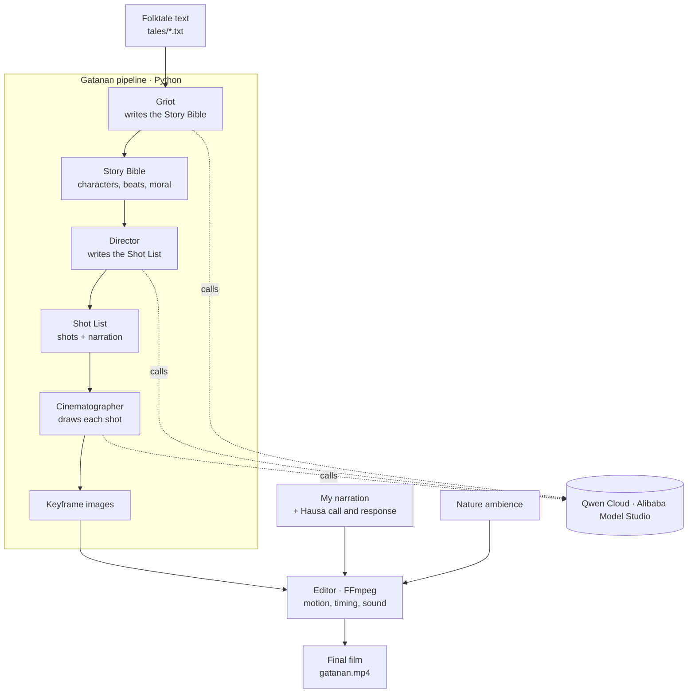

# Gatanan

Gatanan turns a written folktale into a narrated animated short film. You give it the text of a tale, and a small team of AI agents reads it, plans the film shot by shot, and generates the artwork. The pieces are then cut together into a finished short.

The first one comes from a Hausa *tatsuniya* I grew up hearing: "Gizo and the Never-Empty Clay Pot," a story about greed. I narrate it myself, and it opens the way these tales always open, with a call to the children and their answer back.

## Why this exists

Almost none of Africa's oral traditions have made it into the tools we are building AI with. Hausa tales are told out loud, at night, by an elder who starts with "Gatanan gatananku." The children answer "Ta zo mu ji ta," and only then does the story begin. I wanted something that could carry a tale into film without sanding that off: keep the names, the clothing, the place, and the lesson, instead of redrawing everything as something Western.

## How it works

Each stage is a separate agent with one job, and every one of them runs on Qwen Cloud.



**The Griot** reads the folktale and writes a Story Bible: the title, the moral, the characters and how they should look, and the beats of the story in order. Its one rule is to stay true to where the tale comes from and never Westernize it.

**The Director** takes that Bible and writes the Shot List: what we see in each shot, how the camera moves, and the line the narrator speaks over it. It also keeps the whole thing inside a budget, so most shots are stills with gentle motion rather than expensive generated video.

**The Cinematographer** draws a keyframe for each shot. It holds one art direction across the whole film so the look stays consistent, and it strips foreign words out of the image prompts so they do not end up printed across the picture.

**The voice** can be cloned with CosyVoice, but the film you will actually watch uses my own narration, including the opening, the closing, and a call-and-response I recorded with real children.

**The editor** is FFmpeg. It takes the images, the motion, the narration, and the background sound, and assembles the final film.

## Qwen Cloud

Everything that thinks or draws runs on Qwen Cloud (Alibaba Model Studio), through one endpoint and one key. The setup is in `app/config.py` and the client is in `app/llm.py`.

| Stage | Model |
| --- | --- |
| Griot and Director | `qwen3.7-plus` |
| Cinematographer | `qwen-image-plus` |
| Voice cloning | `cosyvoice-v3-plus` |

Base URL: `https://dashscope-intl.aliyuncs.com/compatible-mode/v1`

## Built with

Python, FastAPI, Qwen Cloud, and FFmpeg.

## Project structure

```
backend/
  app/
    agents/griot.py      Story Bible from a folktale
    agents/director.py   Shot List from a Story Bible
    media/image_gen.py   Keyframe generation
    llm.py               Qwen Cloud client (chat + JSON mode)
    schemas.py           Pydantic data contracts
    config.py            Qwen Cloud settings and art direction
    main.py              FastAPI service exposing the pipeline
  run_day2.py            Run Griot + Director
  run_day3.py            Run the Cinematographer (all shots or one)
  enroll_voice.py        Clone a narrator voice (CosyVoice)
  tales/                 Source folktale texts
DEPLOY.md                Deploy the backend on Alibaba Cloud
```

## Running it

You will need Python 3.10 or newer and a Qwen Cloud API key.

```bash
cd backend
python3 -m venv .venv && source .venv/bin/activate
pip install -r requirements.txt
echo "DASHSCOPE_API_KEY=sk-your-key" > .env
```

Generate the plan and the keyframes from a tale:

```bash
python run_day2.py       # Griot + Director -> story_bible.json, shot_list.json
python run_day3.py all   # Cinematographer -> keyframe images
```

Or run the backend as an API:

```bash
uvicorn app.main:app --host 0.0.0.0 --port 8000
# then open http://localhost:8000/docs and try the /plan endpoint
```

## Deploying on Alibaba Cloud

The backend is meant to run on Alibaba Cloud compute and call Qwen Cloud from there. `DEPLOY.md` walks through standing it up on a Simple Application Server or ECS instance, step by step. The Qwen Cloud endpoint it uses is in `app/config.py` and `app/llm.py`.

## The film

The first short is "Gizo and the Never-Empty Clay Pot," a Hausa folktale about greed. It runs about two minutes, I narrate it, and it opens and closes with the traditional Hausa call and response. Watch it here: https://youtu.be/ohDJNRM72TM

## License

MIT. See [LICENSE](LICENSE).