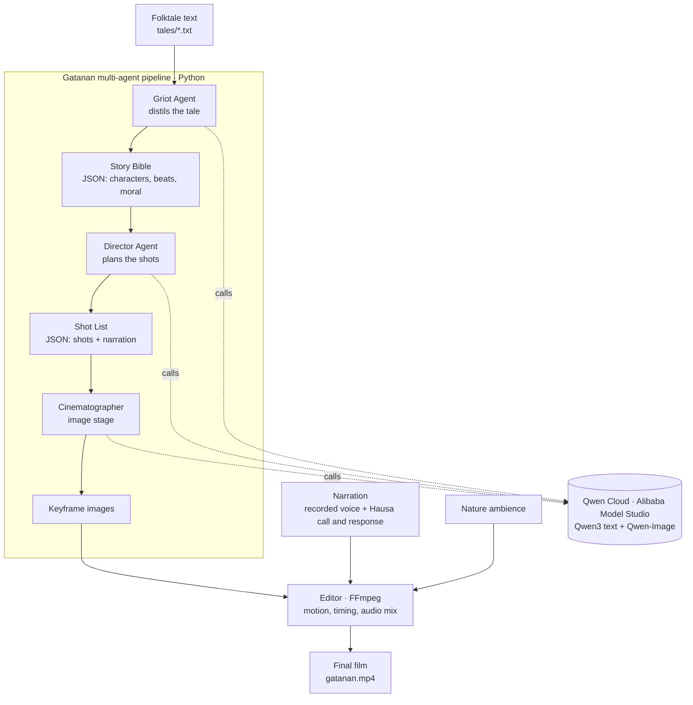

# Gatanan

An autonomous AI showrunner that turns African oral folktales into narrated animated short films.

Gatanan takes the plain text of a folktale and produces a complete film plan: a structured Story Bible, a shot-by-shot Shot List, and generated keyframe images, each faithful to the culture the tale comes from. The planning and the imagery are driven by a team of agents running on Qwen Cloud. The first film is built from the Hausa *tatsuniya* "Gizo and the Never-Empty Clay Pot," a tale about greed, narrated in the storyteller's own voice and opened with the traditional call and response that begins every Hausa tale.

## Why

Africa's oral storytelling traditions are almost absent from modern AI tooling. Hausa *tatsuniya* are told by elders at night, and every telling opens with a call, "Gatanan gatananku," answered by the children, "Ta zo mu ji ta." Gatanan is a step toward giving these traditions a place in the future of AI media, built to preserve the names, dress, settings, and morals of the tale rather than flatten them into a generic Western style.

## How it works

The pipeline is a chain of specialized agents, each with one job.



- **Griot agent** (`app/agents/griot.py`) reads the folktale and distils it into a Story Bible: title, logline, origin, moral, cultural motifs, characters with visual notes, and an ordered emotional beat sheet. It is instructed to preserve the culture of origin and never Westernize the tale.
- **Director agent** (`app/agents/director.py`) turns the Bible into a Shot List, deciding for each beat what we see, the framing, the camera motion, and the narrator's line, while keeping the plan inside a time and cost budget.
- **Cinematographer** (`app/media/image_gen.py`) renders a keyframe for each shot. It injects a single film-wide art direction for a consistent look, and strips parenthetical foreign terms from prompts so they are not accidentally painted onto the image as text.
- **Voice module** (`enroll_voice.py`) can clone a narrator voice with CosyVoice. The shipped film uses the creator's own narration, including the Hausa opening and closing and a call-and-response recorded with real children.
- **Editor** (FFmpeg) assembles the keyframes, motion, narration, and ambience into the finished film.

## Qwen Cloud usage

Every model call goes to Qwen Cloud (Alibaba Model Studio) through a single OpenAI-compatible endpoint and one API key. The base URL and models are set in `app/config.py`, and the client is in `app/llm.py`.

| Stage | Model |
| --- | --- |
| Griot and Director agents | `qwen3.7-plus` (text) |
| Cinematographer | `qwen-image-plus` (text to image) |
| Voice cloning | `cosyvoice-v3-plus` |

Base URL: `https://dashscope-intl.aliyuncs.com/compatible-mode/v1`

## Tech stack

Python, FastAPI, Qwen Cloud (Alibaba Model Studio), FFmpeg.

## Project structure

```
backend/
  app/
    agents/griot.py      Story Bible from a folktale
    agents/director.py   Shot List from a Story Bible
    media/image_gen.py   Keyframe generation
    llm.py               Qwen Cloud client (chat + JSON mode)
    schemas.py           Pydantic data contracts
    config.py            Qwen Cloud settings and art direction
    main.py              FastAPI service exposing the pipeline
  run_day2.py            Run Griot + Director
  run_day3.py            Run the Cinematographer (all shots or one)
  enroll_voice.py        Clone a narrator voice (CosyVoice)
  tales/                 Source folktale texts
DEPLOY.md                Deploy the backend on Alibaba Cloud
```

## Running it

Prerequisites: Python 3.10 or newer, and a Qwen Cloud API key.

```bash
cd backend
python3 -m venv .venv && source .venv/bin/activate
pip install -r requirements.txt
echo "DASHSCOPE_API_KEY=sk-your-key" > .env
```

Generate a film plan and keyframes from a tale:

```bash
python run_day2.py       # Griot + Director -> story_bible.json, shot_list.json
python run_day3.py all   # Cinematographer -> keyframe images
```

Or run the backend as an API:

```bash
uvicorn app.main:app --host 0.0.0.0 --port 8000
# then open http://localhost:8000/docs and try the /plan endpoint
```

## Deployment on Alibaba Cloud

The backend is built to run on Alibaba Cloud compute and call Qwen Cloud. `DEPLOY.md` is a step-by-step guide to standing it up on a Simple Application Server or ECS instance. Proof of Qwen Cloud usage lives in `app/config.py` and `app/llm.py`.

## The film

The first short adapts the Hausa folktale "Gizo and the Never-Empty Clay Pot." It runs about two minutes, is narrated by the creator, and opens and closes with the traditional Hausa call and response. Watch the demo video: [add your YouTube link here].

## License

MIT. See [LICENSE](LICENSE).
